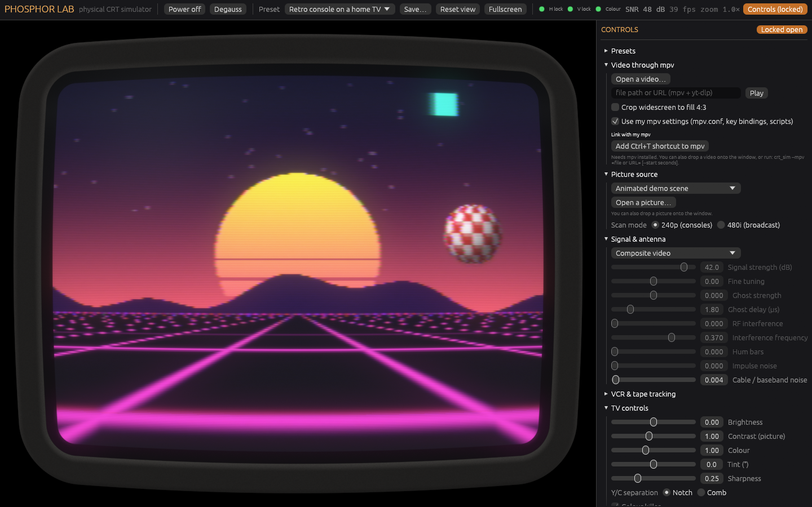
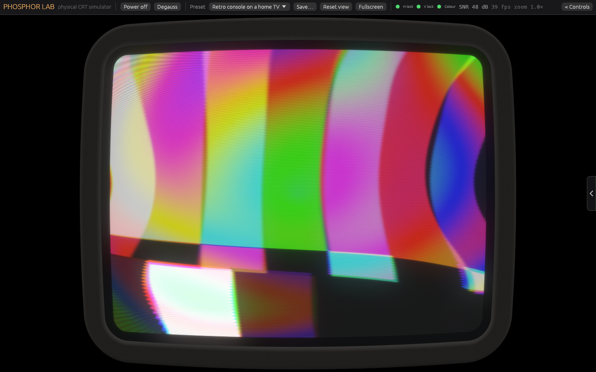
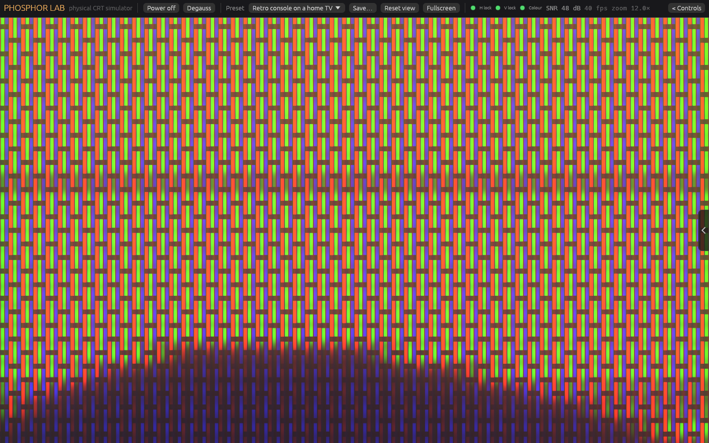

# Phosphor Lab

A physically based CRT television simulator written in Rust and OpenGL.

Phosphor Lab models the full analog television pipeline — from NTSC baseband encoding, RF/VCR signal degradation, and horizontal/vertical sync oscillators, through electron beam optics, shadow-mask/aperture-grille physics, phosphor persistence, rolling-scan illumination, and faceplate glass optics, alongside a synchronized analog audio DSP path.


## Features

- **Full Analog Signal Chain (GPU + CPU)**
  - **Inputs**: RF antenna (broadcast), Composite video, S-Video (Y/C), and Component / RGB.
  - **RF & Channel Physics**: Carrier-to-noise snow with tuner AGC, IF slope fine-tuning, multipath ghosting, diagonal herringbone RF interference, rolling mains hum bars, impulse noise, notch vs. comb Y/C separation, and colour killer with hysteresis.
  - **Sync Oscillators**: Per-line horizontal AFC phase-locked loop (tearing on lost H-hold) and vertical field oscillator (rolling on lost V-hold).
  - **VCR & Tape Simulation**: SP/LP/EP luma bandwidth, colour-under chroma delay and streaking, tape wear, oxide dropouts, head-switch skew, timebase wobble, tracking noise bands, and edge-enhancement halos.
- **Picture Tube & Phosphor Physics**
  - **Masks**: Aperture grille (with damper wires), Slot mask, and Shadow mask (hexagonal dot triads) with configurable pitch, black matrix, and anti-aliased filtering when zoomed out.
  - **Electron Optics**: Per-gun gamma, focus loss, beam spot width/height, current-dependent spot blooming, static and dynamic corner convergence, auto beam limiter (ABL), and HV breathing.
  - **Phosphor & Glass**: P22, EBU, and Vivid phosphor primary matrices, colour temperature white point, per-phosphor fast/slow decay, saturation, faceplate curvature, glass browning, diffusion, halation, ambient reflections, and progressive phosphor burn-in.
  - **Rolling Scan & High-Speed Camera Mode**: Simulates the beam painting each line across the field with slow-motion playback (up to 20,000×) and adjustable camera exposure.
  - **PTC Coil Degaussing**: Perimeter AC degaussing coil with PTC thermistor decay envelope, Lorentz-force geometric warp (pinch/barrel, torsional swirl, vertical S-wave, transient RGB misconvergence), continuous triad purity colour rings, and synchronized coil buzz/thump audio.
- **Synchronized Analog Audio DSP**
  - Routes video audio (or 1 kHz colour-bars test tone) through VCR tape wow/flutter/hiss, RF FM sound hiss/static/clicks/intercarrier buzz, cabinet speaker frequency response (scaled to screen size), 15.7 kHz flyback whine, power crackle, and degauss coil buzz.
- **Video & Image Playback**
  - Play local video files or URLs (via `mpv` / `yt-dlp`), drag and drop images or videos onto the window, forward your own `mpv` key bindings while hovering the screen, or install the built-in `Ctrl+T` mpv script to hand off playback from mpv directly to Phosphor Lab.
- **Slide-in Controls & Custom Presets**
  - Slide-in right-hand controls drawer (hover the right edge, click the edge tab, or toggle **Controls**) that can be **locked open** beside the TV or tucked away for an unobstructed view.
  - Includes 9 built-in presets and lets you **save, overwrite, and delete custom presets** stored in your user config directory.

## Screenshots

| Controls & Presets (Locked Open) | Degaussing Coil Physics |
| :---: | :---: |
|  |  |

| Close-up Phosphor Mask (12× Zoom) |
| :---: |
|  |

## Getting Started

### Prerequisites

- **Rust toolchain** (edition 2024 — Rust 1.85+)
- **OpenGL 3.3+ / OpenGL ES 3.0+** capable GPU/driver
- **Optional (for video playback)**: `libmpv` or the `mpv` CLI binary (plus `yt-dlp` for URLs)
- **Optional (for audio output on Linux)**: `pacat` (PulseAudio/PipeWire), `pw-cat`, `aplay`, or `mpv`

On Debian/Ubuntu, install the windowing build dependencies if needed:

```bash
sudo apt-get install libxcb-render0-dev libxcb-shape0-dev libxcb-xfixes0-dev libxkbcommon-dev libgtk-3-dev
```

### Build & Run

```bash
cargo run --release
```

Or use the helper launcher script (builds the release binary when needed and forwards CLI arguments):

```bash
./phosphor-lab.sh
```

### Run Tests

```bash
cargo test
```

## Controls & Shortcuts

| Action | Input |
| --- | --- |
| Slide controls drawer in | Hover the right edge, click the right-edge pull tab, or click **Controls** |
| Lock / unlock sidebar | Click **Lock open** / **Locked open** in the sidebar header |
| Save a preset | Click **Save…** in the top bar or open **Presets** inside the sidebar |
| Zoom into phosphors | Mouse wheel over the screen |
| Pan zoomed view | Click and drag on the screen |
| Reset zoom & pan | Double-click the screen (or click **Reset view**) |
| Toggle fullscreen | `F11` (press `F11` or `Esc` to exit) |
| Open image or video | Drag & drop onto the window, or use **Open a picture…** / **Open a video…** |
| Control `mpv` playback | Hover the TV and use your `mpv` keys (`Space`, arrow keys, etc.) |

## CLI Options

```bash
crt_sim [OPTIONS] [VIDEO_PATH_OR_URL]
```

- `--mpv <path-or-url>` — Play a video file or URL on startup
- `--start <seconds>` — Start video playback at the given timestamp
- `--preset <0..8>` — Start with a built-in preset
- `--pattern <0..8>` — Start with a specific test pattern
- `--zoom <1.0..60.0>` — Initial zoom factor
- `--sidebar` — Start with the controls sidebar locked open
- `--fullscreen` — Start in fullscreen mode
- `--screenshot <path>` — Render and save a screenshot, then exit

## Saved Presets

Custom presets are saved as plain-text `.preset` files in your platform config folder:

- **Linux**: `$XDG_CONFIG_HOME/phosphor-lab/presets/` (default `~/.config/phosphor-lab/presets/`)
- **macOS**: `~/Library/Application Support/phosphor-lab/presets/`
- **Windows**: `%APPDATA%\phosphor-lab\presets\`

## Project Structure

```text
src/
├── main.rs      # CLI argument parsing and window setup
├── app.rs       # egui interface, slide-in controls drawer, preset UI, scan clock
├── settings.rs  # Simulation knobs, built-in presets, and user preset persistence
├── sim.rs       # Per-line/per-field CPU simulation (sync AFC, VCR tracking, PTC degauss)
├── gpu.rs       # Multi-pass OpenGL framebuffer pipeline
├── shaders.rs   # GLSL shaders (source, baseband, RF channel, decode, beam/mask, scan, glass)
├── audio.rs     # Real-time analog TV/RF/VCR/cabinet audio DSP engine
├── mpv.rs       # Video playback via dynamically loaded libmpv or mpv CLI fallback
├── link.rs      # Local IPC socket and mpv Ctrl+T handoff script installer
└── about.rs     # Procedural app icon and Linux desktop menu entry helper
```

## License

MIT — see [LICENSE](LICENSE).
