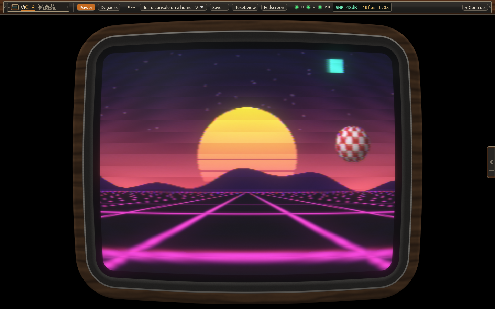

# ViCTR — Virtual CRT Television Receiver

A physically based CRT television simulator written in Rust and `wgpu` (Vulkan, DirectX 12, Metal) with native HDR display output, wrapped in a retro faux-walnut and brushed-metal receiver interface.

ViCTR models the full analog television pipeline — from NTSC baseband encoding, RF/VCR signal degradation, and horizontal/vertical sync oscillators, through electron beam optics, shadow-mask/aperture-grille physics, phosphor persistence, rolling-scan illumination, and faceplate glass optics, alongside a synchronized analog audio DSP path.



## Features

- **Full Analog Signal Chain (GPU + CPU)**
  - **Inputs**: RF antenna (broadcast), Composite video, S-Video (Y/C), and Component / RGB.
  - **RF & Channel Physics**: Carrier-to-noise snow with tuner AGC, IF slope fine-tuning, multipath ghosting, diagonal herringbone RF interference, rolling mains hum bars, impulse noise, notch vs. comb Y/C separation, and colour killer with hysteresis.
  - **Sync Oscillators**: Per-line horizontal AFC phase-locked loop (tearing on lost H-hold) and vertical field oscillator (rolling on lost V-hold).
  - **VCR & Tape Simulation**: SP/LP/EP luma bandwidth, colour-under chroma delay and streaking, tape wear, oxide dropouts, head-switch skew, timebase wobble, tracking noise bands, and edge-enhancement halos.
- **Picture Tube & Phosphor Physics**
  - **Masks**: Aperture grille (with damper wires), Slot mask, and Shadow mask (hexagonal dot triads) with configurable pitch, black matrix, anti-moiré alignment/pre-filtering, and `Ctrl+1` 1:1 pixel-perfect screen sizing.
  - **Electron Optics**: Per-gun gamma, focus loss, beam spot width/height, current-dependent spot blooming, static and dynamic corner convergence, auto beam limiter (ABL), and HV breathing.
  - **Phosphor & Glass**: P22, EBU, and Vivid phosphor primary matrices, colour temperature white point, per-phosphor fast/slow decay, saturation, faceplate curvature, glass browning, diffusion, halation, ambient reflections, progressive phosphor burn-in, and a woodgrain-trimmed CRT cabinet bezel.
  - **Native HDR Output (OLED / HDR)**: Uses a linear 16-bit floating-point CRT pipeline presented directly onto native HDR swapchains — `Rgba16Float` scRGB on Windows (DirectX 12) and Linux (Vulkan/Wayland), `Rgba16Float` EDR on macOS (Metal), and 10-bit `Rgb10a2Unorm` HDR10 PQ fallback — so individual glowing phosphors can hit 600–1,000+ nits while unlit areas remain true `0.000` pure black and the UI stays at comfortable paper-white brightness. Automatically falls back to SDR on standard displays.
  - **Rolling Scan & High-Speed Camera Mode**: Simulates the beam painting each line across the field with slow-motion playback (up to 20,000×) and adjustable camera exposure.
  - **PTC Coil Degaussing**: Perimeter AC degaussing coil with PTC thermistor decay envelope, Lorentz-force geometric warp (pinch/barrel, torsional swirl, vertical S-wave, transient RGB misconvergence), continuous triad purity colour rings, and synchronized coil buzz/thump audio.
  - **Chaos Engine & Percussive Maintenance (Optional)**: Toggleable novelty mode where realistic analog signal & sync faults occasionally drift (weak signal/snow, multipath ghosting, VCR tracking, timebase warble, H/V-hold slip, hum/supply ripple) until you hit **Whack!** (or press `K`) for a hollow wooden cabinet thwack and mechanical jolt that knocks it back into gear.
- **Synchronized Analog Audio DSP**
  - Routes video audio (or 1 kHz colour-bars test tone) through VCR tape wow/flutter/hiss, RF FM sound hiss/static/clicks/intercarrier buzz, cabinet speaker frequency response (scaled to screen size), 15.7 kHz flyback whine, power crackle, and degauss coil buzz.
- **Video & Image Playback**
  - Play local video files or URLs (via `mpv` / `yt-dlp`), drag and drop images or videos onto the window, forward your own `mpv` key bindings while hovering the screen, or install the built-in `Ctrl+T` mpv script to hand off playback from mpv directly to ViCTR.
- **90s Prevue Cable Guide & Jellyfin Integration**
  - Connect to your **Jellyfin** server (Server URL + API Key + User selector) to unlock a classic 1990s **Prevue Channel** split-screen cable guide rendered straight through the NTSC signal path (live video preview + Jellyfin artwork/synopsis + 30-minute scrolling grid).
  - Automatically builds virtual channels: **`CH 01`** Program Guide, **`CH 02+`** per-series channels (Continue Watching & Favorites first, resuming your next unwatched episode and auto-advancing), and **`CH 50+`** 24/7 live-clock movie genre channels (`ACTION`, `COMEDY`, `SCI-FI`, etc.).
  - Syncs playback progress & watched status back to Jellyfin after >20 seconds of viewing (so quick channel-surfing stays clean) and marks items watched at 90% completion.
  - Injects a classic **phosphor-green/white TV OSD** (`CH 04`, call-sign, episode banner, `VOL |||||||---`, `MUTE`, `STEREO`/`MONO`) post-decoder into the electron guns, paired with a brief RF static burst & tuner click on channel switches.
- **Slide-in Service Panel & Custom Presets**
  - Retro faux-walnut and brushed-metal slide-in controls drawer accessible in both windowed and fullscreen modes: a subtle low-opacity pull handle rests on the right edge, brightens on hover, and toggles the panel open or closed on click while the CRT glides smoothly alongside it.
  - Includes 9 built-in presets and lets you **save, overwrite, and delete custom presets** stored in your user config directory.

## Screenshots

| Service Panel (Locked Open) | Degaussing Coil Physics |
| :---: | :---: |
|  |  |

| Close-up Phosphor Mask (12× Zoom) |
| :---: |
|  |

## Platform Support

| Feature | Linux | macOS | Windows |
| --- | :---: | :---: | :---: |
| CRT physics & `wgpu` rendering | Native (Vulkan / GLES) | Native (Metal) | Native (DirectX 12 / Vulkan) |
| Native HDR display output | Vulkan scRGB / HDR10 PQ (Wayland HDR) | Metal EDR (`Rgba16Float`) | DirectX 12 scRGB / HDR10 PQ |
| Slide-in UI, image loading, saved presets | Native | Native | Native |
| Video playback via `mpv` / `libmpv` | Native | Native (with `mpv` / `libmpv` installed) | Native (with `mpv` / `libmpv-2.dll` installed) |
| Simulated TV audio DSP output | `pacat` / `pw-cat` / `aplay` / `mpv` / `ffplay` | Requires `mpv` or `ffplay` in `PATH` | Requires `mpv` or `ffplay` in `PATH` (video audio plays directly via `mpv`) |
| Single-instance `Ctrl+T` handoff socket | Native (Unix socket) | Native (Unix socket) | Launches a new window |

## Getting Started

### Prebuilt Releases

Prebuilt binaries for **Windows (x86_64)**, **macOS (Apple Silicon & Intel)**, and **Linux (x86_64)** are published on the [GitHub Releases](../../releases) page whenever a version tag (`v*`) is pushed.

### Prerequisites

- **Rust toolchain** (edition 2024 — Rust 1.87+)
- **Vulkan / DirectX 12 / Metal / OpenGL ES 3.0+** capable GPU/driver (HDR requires OS/compositor HDR enabled)
- **Optional (for video playback)**: `libmpv` or the `mpv` CLI binary (plus `yt-dlp` for URLs)
- **Optional (for simulated TV sound)**: `pacat` / `pw-cat` / `aplay` on Linux, or `mpv` / `ffplay` on macOS and Windows

On Debian/Ubuntu, install the windowing build dependencies if needed:

```bash
sudo apt-get install libxcb-render0-dev libxcb-shape0-dev libxcb-xfixes0-dev libxkbcommon-dev libgtk-3-dev
```

### Build & Run

```bash
cargo run --release
```

On Linux/macOS, you can also use the helper launcher script (rebuilds release automatically when source changes):

```bash
./victr.sh
```

### Run Tests

```bash
cargo test
```

## Controls & Shortcuts

| Action | Input |
| --- | --- |
| Open / close service panel | Click the right-edge pull handle (works in fullscreen too) or **Controls** in the top bar |
| Resize service panel | Drag the left edge of the open service panel |
| Save a preset | Click **Save…** in the top bar or open **Presets** inside the service panel |
| Zoom into phosphors | Mouse wheel over the screen |
| Pan zoomed view | Click and drag on the screen |
| Reset zoom & pan | Double-click the screen (or click **Reset view**) |
| Pixel-perfect 1× phosphors | `Ctrl+1` (`Cmd+1` on macOS) or click **1:1** next to **Screen size (in)** |
| Toggle fullscreen | `F11` (press `F11` or `Esc` to exit) |
| Open image or video | Drag & drop onto the window, or use **Open a picture…** / **Open a video…** |
| Control `mpv` playback | Hover the TV and use your `mpv` keys (`Space`, arrow keys, etc.) |
| 90s Cable Guide & TV Remote (Jellyfin) | `G` (Guide), `E` or right-click row (Episode/Movie Picker, Left/Right jumps seasons), `W` (Mark Watched/Unwatched), `N`/`P` (Next/Prev Episode), Arrows + `Enter`, `0–9` (dial channel), `PgUp`/`PgDn` or `[`/`]` (Ch+/Ch-), `-`/`+` (Vol), `M` (Mute), `R` (Restart 0:00), `I` (Info OSD) |

## CLI Options

```bash
victr [OPTIONS] [VIDEO_PATH_OR_URL]
```

- `--mpv <path-or-url>` — Play a video file or URL on startup
- `--start <seconds>` — Start video playback at the given timestamp
- `--preset <0..8>` — Start with a built-in preset
- `--pattern <0..8>` — Start with a specific test pattern
- `--zoom <1.0..60.0>` — Initial zoom factor
- `--sidebar` — Start with the service panel locked open
- `--guide` — Open the 90s Prevue Cable Guide (`CH 01`) on startup when Jellyfin is connected
- `--fullscreen` — Start in fullscreen mode
- `--screenshot <path>` — Render and save a screenshot, then exit

## Saved Presets

Custom presets are saved as plain-text `.preset` files in your platform config folder:

- **Linux**: `$XDG_CONFIG_HOME/victr/presets/` (default `~/.config/victr/presets/`)
- **macOS**: `~/Library/Application Support/victr/presets/`
- **Windows**: `%APPDATA%\victr\presets\`

## Project Structure

```text
src/
├── main.rs      # CLI argument parsing and window setup
├── app.rs       # Retro walnut & brushed-metal egui interface, slide-in drawer, preset UI
├── settings.rs  # Simulation knobs, built-in presets, and user preset persistence
├── sim.rs       # Per-line/per-field CPU simulation (sync AFC, VCR tracking, PTC degauss)
├── gpu.rs       # Multi-pass wgpu linear HDR framebuffer pipeline & native HDR/SDR presenter
├── shaders.rs   # WGSL shader loader
├── shaders.wgsl # WGSL shaders (source, baseband, RF channel, decode, beam/mask, scan, glass, HDR present)
├── audio.rs     # Real-time analog TV/RF/VCR/cabinet audio DSP engine
├── jellyfin.rs  # Jellyfin REST client, virtual channel builder, hybrid scheduler & watch sync
├── guide.rs     # 640×480 classic 1990s Prevue Channel split-screen bitmap renderer
├── osd.rs       # 8×8 pixel font & post-decoder phosphor-green/white TV OSD
├── mpv.rs       # Video playback via dynamically loaded libmpv or mpv CLI fallback
├── link.rs      # Local IPC socket and mpv Ctrl+T handoff script installer
└── about.rs     # Procedural retro TV icon and Linux desktop menu entry helper
```

## License

MIT — see [LICENSE](LICENSE).
